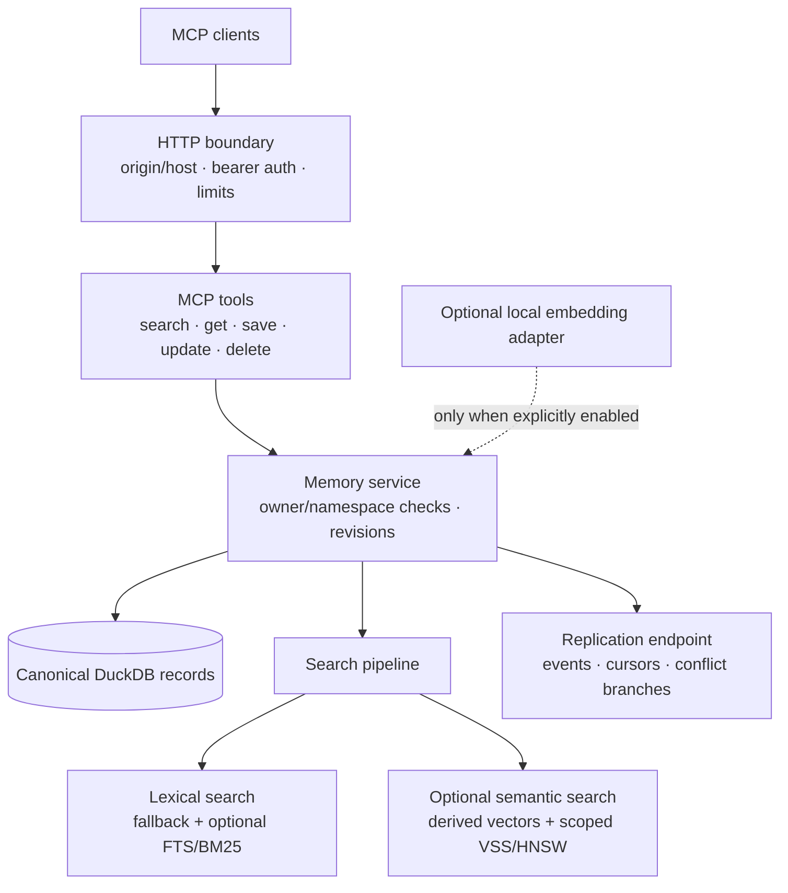
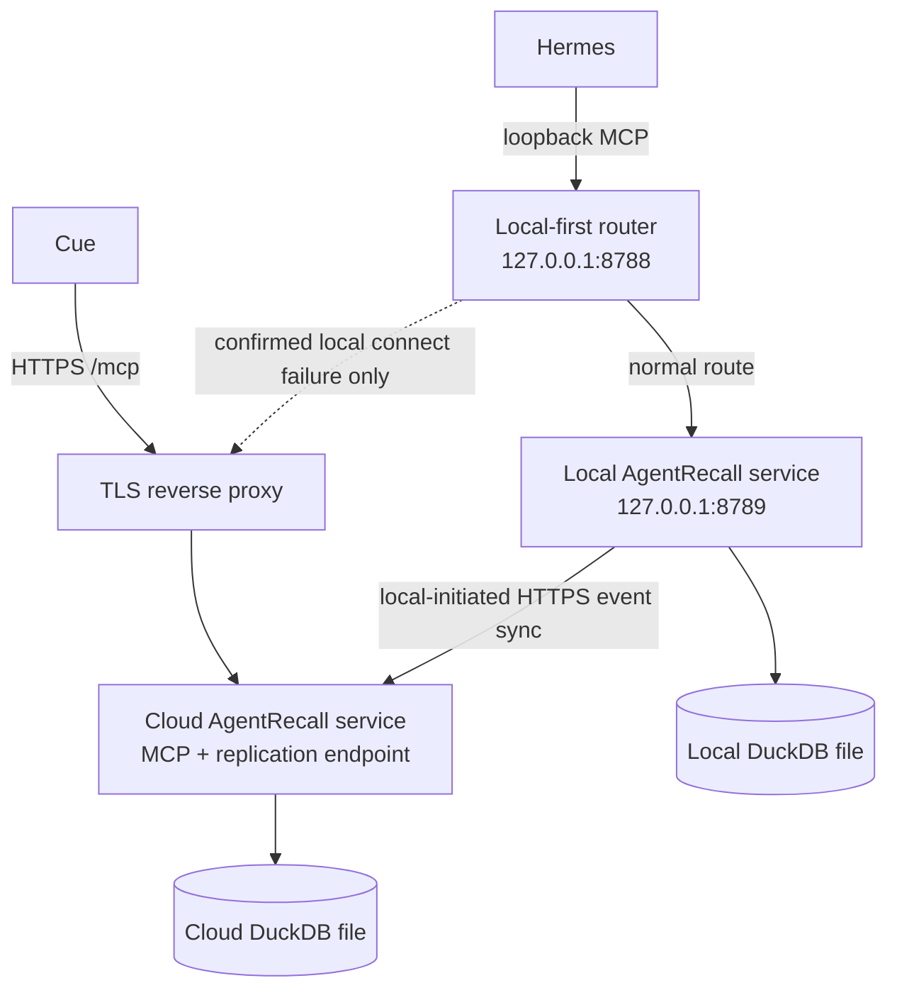

# AgentRecall

**Author:** Iakov Filimonov  
**License:** MIT

AgentRecall is a self-hostable shared-memory service for AI agents and applications. It is written in Rust and exposes memory operations over MCP Streamable HTTP, with an embedded DuckDB database owned by each service instance. Clients use the service API; they never open database files directly.

> **Status: prototype.** On Rust 1.100.0, `cargo fmt --check`, `cargo check --all-targets`, the 57-test `cargo test --all-targets` suite, strict Clippy, and CLI help passed locally; the release build passed in the prior validation. A real local BGE-M3 smoke test initialized the model, saved a Cantonese memory, and retrieved it with an English query. That service run had no VSS extension, so it used exact owner/namespace-scoped vector scoring; it did not exercise HNSW. A scripted single-node deployment (`scripts/local-deploy.sh`) was validated end to end on macOS with launchd, including an idempotent reinstall, a verified backup, and a clean uninstall; in that deployment the VSS extension was provisioned and `/health/ready` reported `hnsw_active: true` with `search_engine: duckdb_vss_hnsw`, and cross-lingual retrieval returned scored hits. Automated tests cover verified backup/restore, fresh-identity snapshot seeding, atomic stale-watermark rejection, and two-database recovery after a restart and partition. Full live two-node acceptance, Cue integration, and production deployment/security checks remain. See [implementation status and release gates](docs/implementation-status.md).

## What it provides

- Five MCP tools: `memory_search`, `memory_get`, `memory_save`, `memory_update`, and `memory_delete`.
- Per-client bearer credentials, owner and namespace authorization, scoped permissions, origin/host checks, request limits, and rate limiting.
- Durable records, optimistic revision checks, idempotent saves, tombstones, expiry collection, and signed, filter-bound search cursors.
- Optional local-initiated replication between independent database instances, with idempotent event application, atomic stale-watermark rejection, snapshot seeding for a fresh peer identity, and explicit retention/resolution of concurrent branches.
- Lexical search remains available without optional extensions; DuckDB FTS/BM25 and semantic search are implemented. The local BGE-M3 provider smoke passed, using exact scoped-vector fallback because VSS was not installed.
- An optional loopback-only router for Hermes that prefers the local service and uses the cloud route only under narrowly defined connection-failure conditions.
- A scripted single-node deployment (`scripts/local-deploy.sh`) that installs, inspects, backs up, and removes a loopback-only service plus router, with locally generated `0600` secrets that are never printed.

## Architecture

A request enters through the MCP HTTP boundary, where the service checks the request origin and host, authenticates the bearer credential, and applies rate limits. The five MCP tools call the memory service, which applies owner/namespace authorization and revision rules before reading or writing the canonical DuckDB records. Search indexes and embeddings are derived projections, not the source of truth.



The FTS and VSS indexes are rebuildable search aids. The service explicitly provisions extensions; startup does not download them. The BGE-M3 provider is opt-in through `AGENTRECALL_EMBEDDING_PROVIDER=bge-m3`. First use downloads model weights from Hugging Face to the local cache, while embedding inference runs in process. The release build passed, and a real local BGE-M3 inference smoke was separately completed. In that smoke, VSS was not installed, so semantic retrieval used exact owner/namespace-scoped vector scoring rather than HNSW. `.fastembed_cache/` is ignored by Git, and the model cache was not published. Without the provider setting, search remains lexical. No memory text is sent to an external embedding provider. See [VSS implementation notes](docs/vss-reference.md).

## Optional two-node topology

Replication is optional: AgentRecall also supports a standalone single-node deployment with no peer configured. When using two nodes, give the local and cloud instances separate DuckDB files. Cue connects to the cloud MCP endpoint over HTTPS. Hermes connects to one local router endpoint; the router normally forwards to the local service. The local service initiates authenticated replication to the cloud endpoint, so the local node can sit behind a home NAT or firewall.



Replication is eventual, not a shared-database transaction. Each node owns and writes only its own database file; never mount one DuckDB file into multiple writer processes or copy files to synchronize nodes. Concurrent same-base writes are retained as conflict branches rather than silently applying last-writer-wins. The router does not access DuckDB and does not retry an ambiguous request. Its hashed write-route affinity currently lacks an acknowledgement-based retirement lifecycle tied to replication; this remains a release gate. See [deployment guidance](docs/deployment.md), [operations](docs/operations.md), and the [memory policy](docs/memory-policy.md).

## Build and run locally

Requirements: Rust 1.100 or later and a C/C++ toolchain for the bundled DuckDB build. The following checks passed locally with Rust 1.100.0; see [implementation status](docs/implementation-status.md) for the provider smoke details and remaining release gates. The application does not automatically load a `.env` file; export settings through your shell or service manager.

```sh
cargo fmt --check
cargo check --all-targets
cargo test --all-targets
cargo clippy --all-targets --all-features -- -D warnings
cargo build --release
cargo run --release -- --help
```

Create separate credentials for each client. Credentials include an owner, client ID, scopes, and namespace allowlist; the raw token is shown only once, while the token file stores its hash. Revoke all active tokens for a client with `revoke-token --client-id <client-id>`, or replace its single active token with `rotate-token --client-id <client-id>`. Both updates are atomic; the service must restart to load the changed token file. See the [operator steps and acceptance evidence](docs/operations.md#client-token-revocation-and-rotation). For overlapping cursor-signing-key rotation, see the [cursor-key rotation procedure](docs/operations.md#cursor-signing-key-rotation).

```sh
cargo run --release -- create-token \
  --owner-id private-owner \
  --client-id cue \
  --scopes memory:read,memory:write \
  --tokens-file ./config/tokens.json

cargo run --release -- serve
```

The service exposes aggregate Prometheus metrics at `/metrics` and detailed readiness, including replication lag and HNSW-active state, at `/health/ready`. Restrict health and metrics routes to trusted monitoring networks; see [metrics and readiness operations](docs/operations.md#metrics-and-readiness).

The service listens on `127.0.0.1:8789` by default and fails closed if its token file is missing or invalid. See [.env.example](.env.example) for the `AGENTRECALL_` settings. Do not commit real credentials or secrets.

For Hermes local-first routing, run `cargo run --release -- serve-router` on the Hermes machine and configure Hermes with only the loopback router endpoint and ingress credential. The router keeps separate local-service and optional cloud-fallback credentials; leave both cloud variables unset for local-only operation. Follow the complete [deployment guide](docs/deployment.md); registering a server alone does not install memory-use behavior in either client.

## Deployment

AgentRecall runs as a single-node service that owns one DuckDB file. Two deployment variants are supported: a scripted single-node deployment for one machine, and an explicit deployment for the two-node local+cloud topology.

### Variant 1: single-node deployment on one machine

`scripts/local-deploy.sh` installs, inspects, backs up, and removes a loopback-only deployment: one MCP service on `127.0.0.1:8789` plus the optional Hermes router on `127.0.0.1:8788`. Application files and secret files stay under one prefix; launchd plists and systemd user units are written to their standard per-user service directories. Secrets are generated locally with `0600` permissions, and no raw token is ever printed.

```sh
git clone https://github.com/watchcat/agentrecall.git
cd agentrecall
./scripts/local-deploy.sh install
```

The install step builds the release binary, generates the cursor, service, and router secrets, creates the client token, provisions the DuckDB FTS and VSS extensions, writes the supervisor units (launchd on macOS, systemd user units on Linux), starts the service, and prints the Hermes wiring:

```
==> Hermes wiring
  AGENTRECALL_MCP_URL=http://127.0.0.1:8788/mcp
  AGENTRECALL_MCP_TOKEN=<the contents of ~/.local/share/agentrecall/config/router_ingress.secret>
  AGENTRECALL_NAMESPACE=shared
```

Read the token from the file rather than from the output; the script never prints it.

| Command | Effect |
| --- | --- |
| `scripts/local-deploy.sh status` | Reports the supervisor state, the service health, and the file layout |
| `scripts/local-deploy.sh env` | Prints the Hermes wiring block again |
| `scripts/local-deploy.sh backup` | Writes a verified checkpointed backup into the prefix |
| `scripts/local-deploy.sh uninstall` | Stops the services and removes the supervisor units; the database and secrets stay |
| `scripts/local-deploy.sh uninstall --purge` | Also deletes the prefix directory, including the database and all secrets |

The install step is idempotent. Running it again reuses the active client token, re-provisions the extensions, and restarts the service instead of creating a second credential.

Useful options: `--prefix` moves the installation root, `--bind` and `--router-bind` change the loopback ports, `--client` and `--owner` set the identity of the created token, `--scopes` and `--namespaces` set its permissions, `--supervisor` selects `launchd`, `systemd`, or `none`, `--no-router` installs the service only, `--no-embeddings` keeps search lexical, `--no-extensions` skips extension provisioning, and `--binary` uses an already built binary instead of compiling.

A backup needs the service stopped, because DuckDB allows a single writer per file. With launchd or systemd, the script stops only the services that were active, verifies the backup, then restores their prior state even if backup or verification fails. With `--supervisor none`, the script refuses to run a managed backup because it cannot stop or restore a manually launched service; stop it yourself and run the binary's `backup` command directly.

### Variant 2: explicit deployment

Use this variant for the two-node local+cloud topology, for a shared host, or when the supervisor and TLS termination are managed outside AgentRecall.

1. Build the binary on each node and create a separate credential per client.
2. Run the service on the local node, bound to loopback, and run the router on the same machine.
3. Terminate TLS in a trusted reverse proxy and publish only the cloud MCP endpoint; see [examples/deployment/Caddyfile](examples/deployment/Caddyfile).
4. Configure the cloud node, the replication credentials, and the peer variables on the local node.

Follow the complete [deployment guide](docs/deployment.md) for the exact environment variables, unit files, and reverse-proxy settings.

| | Variant 1 | Variant 2 |
| --- | --- | --- |
| Topology | One node, loopback only | Local node plus a cloud node behind a reverse proxy |
| Supervisor | launchd or systemd user units, written by the script | Managed by the operator |
| TLS | Not applicable, loopback only | Required for the published cloud endpoint |
| Replication | None | Optional, local-initiated |
| Best for | Hermes on one machine | Shared or remote clients, Cue |

Registering a server alone does not install memory-use behavior in either client.

## Search and replication details

Canonical lexical search is always available. Operators may explicitly provision DuckDB FTS/BM25 and VSS for the pinned build:

```sh
cargo run --release -- install-fts
cargo run --release -- install-vss
```

FTS accelerates lexical retrieval. The semantic search path is covered by a deterministic test adapter, and actual local BGE-M3 inference was smoke-tested through an isolated service: it saved a Cantonese memory and retrieved it with an English query. VSS was not installed for that run, so retrieval used exact owner/namespace-scoped vector scoring and did not exercise HNSW. A later single-node deployment installed through `scripts/local-deploy.sh` did provision VSS and reported `hnsw_active: true` with `search_engine: duckdb_vss_hnsw`, and cross-lingual queries returned scored hits; that evidence covers one node, not a replicated pair. With VSS provisioned, AgentRecall can persist model/version-tagged derived vectors and build per-owner/per-namespace HNSW indexes in memory. Without an embedding adapter, search remains lexical. Expired and deleted records are removed from derived search projections as part of retrieval and mutation handling.

The local replica initiates HTTPS exchanges with the cloud endpoint when `AGENTRECALL_PEER_URL`, `AGENTRECALL_PEER_TOKEN`, and `AGENTRECALL_PEER_REPLICA_ID` are configured. Replication is optional; without a peer, the service can run standalone. Replication credentials are separate from MCP client credentials. Delivery is at-least-once and event application is idempotent. The hourly collector emits tombstones for expired records and prunes mutation history at the first fixed limit reached: 90 days of age or 100,000 events per origin. Neither limit is runtime-configurable, and compaction does not wait for peer acknowledgements. It retains each record's current version envelope with canonical state. Exchanges below a required pruning watermark are rejected atomically before inbound events are applied or either cursor advances. A stale peer cannot recover pruned history by restarting; provision a new peer from a verified snapshot with `seed-peer` and a fresh replica ID. This does not merge writes that exist only on the old stale database, so preserve and reconcile those before replacing it. Conflicts require an operator to inspect retained branches and explicitly resolve them.

Operators can create a checkpointed database backup and restore only to a new, verified destination with `agentrecall backup --database ... --output ...` and `agentrecall restore --backup ... --database ... --verify`. Restore preserves the replica identity; use `seed-peer` from a verified backup to provision a distinct peer with a fresh identity and snapshot-boundary cursors:

```sh
agentrecall seed-peer \
  --backup /var/backups/source-current.duckdb \
  --database /var/lib/agentrecall/new-peer.duckdb \
  --replica-id peer-unique-id
```

Review [deletion and retention](docs/operations.md#deletion-and-retention), [backup/restore](docs/operations.md#backup-and-restore), and the [acceptance checks](docs/operations.md#acceptance-evidence) before rollout.

## Security and production limits

- Put public cloud traffic behind a trusted TLS reverse proxy; do not expose plaintext HTTP publicly.
- Run one read/write process per DuckDB file on durable storage, and keep local and cloud storage separate.
- Keep bearer, replication, cursor-HMAC, and router secrets out of source control, logs, and MCP tool arguments.
- The service logs operational metadata, not memory content or bearer headers; review deployment logging and retention as part of acceptance.
- Encrypt backups at rest and test restore procedures independently for each replica.

The current 57-test local suite exercises retention collection, age/count-bounded event-log compaction independent of peer acknowledgements, current-state preservation, stale-cursor refusal, and verified backup/restore on test databases. Local builds and a BGE-M3 smoke test still do not verify production availability, cloud TLS, real client interoperability, embedding quality/performance at scale, or two-node restart/disconnection acceptance. Complete the remaining [release gates](docs/implementation-status.md) before relying on a public deployment.
