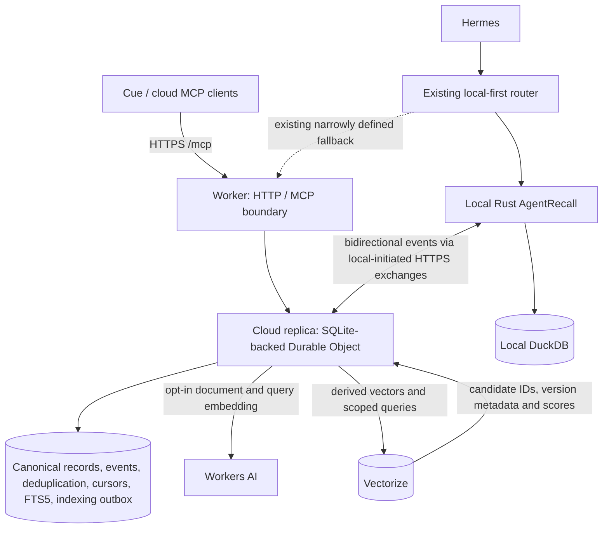

# ADR-001: Managed Cloudflare cloud node

**Status:** accepted architecture direction; not implemented or deployed.

**Decision date:** 26 November 2026.

**Decision owner:** Iakov Filimonov. Documented by Manus AI.

**Scope:** the cloud replica only. The local Hermes service remains Rust + DuckDB.

## Decision

Build the cloud node around a Cloudflare Worker and **SQLite-backed Durable Object storage**, with **Vectorize as a derived semantic-search index**. “Managed SQLite” means the Durable Object option discussed with the user, not D1. The intended embedding provider is Workers AI, subject to explicit configuration and an approved model/data-processing policy.

This replaces the planned native Container → private R2 database route as the active cloud direction. It does not replace AgentRecall's distributed-memory design: the local and cloud nodes keep independent databases, exchange canonical mutation events, and serve their respective MCP clients. No shared database file or cloud dependency is introduced into ordinary local operation.

The reason is operational simplicity. The managed route removes the need to deploy a native cloud binary, preserve its ephemeral container disk, provision DuckDB cloud extensions, and validate S3-backed database storage. In exchange, the cloud node needs its own implementation of the existing API and replication behavior. This is not a storage-setting change to the unchanged Rust binary.

## Topology and responsibilities

The Worker supplies the public HTTP/MCP boundary and routes requests to the intended cloud replica. Authentication, owner/namespace authorization, payload limits and rate limits remain mandatory. A Durable Object owns cloud canonical state and transaction decisions. Its storage is transactional and strongly consistent, and supports SQLite FTS5. Request interleaving still requires correct transaction boundaries; an object is not permission to perform unguarded application read/modify/write sequences. [1]

SQLite holds canonical memories, version/conflict state, tombstones, mutation events, event deduplication, save idempotency, replica identity, sequence/cursor metadata, pruning watermarks and pending indexing work. Lexical search uses a rebuildable FTS5 projection. Vectorize stores embeddings and minimal lookup/filter metadata, not authoritative memory content or authorization decisions.

The initial acceptance target is one cloud replica paired with one local replica. The implementation specification must settle the Durable Object naming and trust boundary. Do not silently shard per namespace or owner: the existing replica feed uses contiguous origin sequences, and changing feed boundaries requires a protocol design.

## Mutation and replication invariants

A successful cloud mutation must commit its canonical state, mutation event, applicable idempotency state and indexing work atomically in SQLite. Acknowledgment means that canonical transaction is durable; it does **not** mean that Vectorize has already made the new version searchable. Embedding-provider failure must not create a partly applied memory/event transaction.

Port the five existing MCP tools—search, get, save, update and delete—with their current validation, revision, retry and error contracts. Preserve separate MCP and replication credentials. Match JSON/SSE protocol behavior and signed, filter-bound cursor semantics; do not assume that changing database engines preserves them automatically. Retrieval scores and ranking may differ, but authorization, deletion, mutation and retry guarantees must not silently weaken.

Replicate canonical events, not SQLite/DuckDB files or vector-index state. Preserve event IDs, replica IDs, origin sequences, base-event relationships, idempotency envelopes, at-least-once delivery with idempotent application, and atomic stale-watermark refusal. Retain concurrent branches and explicit conflict resolution rather than introducing last-writer-wins. The current event shape is defined in `src/domain.rs`; protocol fixtures must cover the current Rust implementation.

Mixed-language compatibility includes JSON serialization and request fingerprints, timestamp normalization, Unicode validation, and lossless handling of Rust `i64` sequence/revision values. A TypeScript implementation must not silently round them through JavaScript numbers. DuckDB migrations cannot be assumed to run unchanged on SQLite; cloud schema migrations require separate review while local migrations remain untouched.

Known replication/router correctness issues remain gates, especially [AR-001, AR-002 and AR-003](../backlog.md). A managed database does not fix these application-level issues.

## Semantic search and freshness

Generate document embeddings when canonical content changes, and query embeddings when semantic search is requested. Retrieve scoped candidates from Vectorize, load canonical records from SQLite, validate their current version and permissions, then combine semantic candidates with lexical results. Preserve kind/tag filters and test candidate starvation after filtering; do not treat vector metadata as the authorization source.

Vectorize insert, upsert and delete operations are asynchronous. Cloudflare describes visibility as typically a few seconds, not a hard upper bound or immediate read-your-write guarantee. A returned mutation ID is not proof that a query can see the change. [2]

Use a durable indexing outbox written with each applicable canonical mutation. Work must be version-aware and retryable, with identities tied to owner, namespace, memory, canonical version and embedding-model generation. Recheck canonical state before sending content for embedding and before considering a job current. Late work must not resurrect a deleted memory or supersede newer search data. Define ordering, obsolete-job cleanup and reconciliation in the implementation specification rather than relying on remote upsert completion order.

Search must verify owner, namespace, current version, deletion and expiry against SQLite before returning any candidate. This blocks stale/deleted vectors from exposing obsolete content even while remote deletion is pending. Physical vector deletion remains tracked work, not a claim of immediate erasure. Provider/index failures leave canonical get and lexical retrieval available, with degraded semantic readiness clearly reported.

The cloud contract therefore has three separate freshness boundaries: canonical visibility on the cloud replica, eventual local/cloud replication, and eventual semantic-index visibility. The implementation specification must define how clients/diagnostics see indexing lag and degraded mode without inventing incompatible MCP fields. Lexical fallback is not proof that a semantic paraphrase query will find a newly saved memory.

## Embedding models and privacy

Keep embeddings as node-local derived data. The nodes may use different models if each independently embeds its canonical text and uses a compatible model for queries against its own index. Identical search scores or ordering across nodes are not promised.

The existing local provider uses quantized BGE-M3 via FastEmbed 7.8.0 with 1,024 dimensions, identified as `bge-m3-bg3m-q` / `fastembed-7.8.0-gpahal-bge-m3-onnx-int8` in `src/embedding.rs`. Workers AI offers BGE-M3, but that does not establish output equivalence to the local ONNX build. The exact cloud model, dimensions, preprocessing, truncation policy and model-generation identifier remain open. Vectorize dimensions and distance metric are fixed at index creation; changing the embedding configuration requires a reviewed reindex/cutover rather than mixing vector spaces. [3] [4]

Workers AI use sends selected memory and query text to Cloudflare for inference. The architectural choice is not permission to send real memories or activate that processing automatically. Before live use, explicitly define eligible namespaces, provider policy, region/residency expectations, retention/deletion and credentials. Vector values themselves are sensitive derived data and need access controls. Keep raw content, queries, vectors and secrets out of operational logs.

Namespace access control is not residency control. The current replication feed is replica-wide; a namespace named `private` is not automatically local-only. Do not filter events out of a contiguous feed without a compatible design. [AR-014](../backlog.md#ar-014--make-access-control-and-residency-different-promises) remains a prerequisite for real-data use.

## Recovery and operational consequences

Managed SQLite removes the native cloud disk problem, not the need for recovery tests. Durable Object SQLite provides point-in-time recovery, but SQLite recovery and Vectorize recovery are not one distributed transaction. After restore, reconcile/rebuild search projections from canonical state. Define how restored replica identity, sequence history, cursors and pending jobs remain safe for the existing peer; do not reuse rolled-back sequence numbers under the same identity without a verified strategy. [1]

Existing DuckDB backup and `seed-peer` tools do not directly restore a SQLite cloud replica. Specify a verified logical snapshot/seed contract for the mixed-backend pair, preserving current version envelopes and cursor boundaries. Preserve unsent mutations before replacing a stale peer. Recovery cannot be called complete solely because a managed backup exists.

Monitor replication lag separately from indexing lag. Include retry counts, oldest pending indexing work, provider failures, stale-candidate rejection, query embedding latency, lexical/vector component latency and full MCP request latency. Set and test resource, rate and cost budgets; managed services are not a zero-cost assumption.

## Alternatives and prior evidence

Workers KV is not the canonical database: it is eventually consistent and optimized for cached reads. Durable Object storage's own KV API is a different service with transactional storage semantics. D1 remains a viable alternative but is not the selected SQLite backend. [1] [5]

Native Rust Container + R2 remains an optional future alternative, not the next deployment gate. The two successful local proofs remain valid historical evidence for that route. The emulator registry failure and unrun actual R2 backend also remain accurately recorded. Nothing in this decision retroactively turns those proofs into a managed SQLite/Vectorize pass.

The [R2 analysis](../r2-compatibility-testing.md) and [old capability map](../../CAPABILITIES-cloud-poc.md) are retained with supersession notices. R2 is not required for the selected canonical storage or application-facing vector path; any later use for exports, backups or other artifacts needs its own scope. Do not deploy a Container or create an R2 bucket merely because an older plan mentions them.

## Implementation gates still open

This document records the user's choice, not complete module specifications or a build authorization. Before implementation, review a managed-cloud capability map and the corresponding specifications, plan and checklist. These must settle the replica/trust boundary, schema, MCP and replication conformance, model/privacy configuration, version-aware indexing lifecycle, hybrid ranking/pagination, logical seeding and restore procedure.

Acceptance must demonstrate synthetic local DuckDB ↔ cloud SQLite operation in both directions, including duplicate retries, updates/deletes, conflicts, partitions and restarts. It must separately test acknowledged canonical-write recovery, stale-watermark refusal, indexing lag/failure, late embedding jobs after deletion, scope isolation, filtered semantic retrieval, multilingual quality and logical reseeding. [AR-009, AR-018 and AR-020](../backlog.md) remain open. No existing local proof closes these managed-backend gates.

No application code, dependencies, schemas, clients or live routes are changed by this decision. No Worker, Durable Object, Vectorize index, credential, model invocation, paid activation, commit or push is authorized or performed by this documentation task.

## References

[1]: https://developers.cloudflare.com/durable-objects/api/storage-api/ "Durable Object transactional SQLite storage, FTS5 and recovery APIs"
[2]: https://developers.cloudflare.com/vectorize/reference/client-api/ "Asynchronous Vectorize insert, upsert, delete and query APIs"
[3]: https://developers.cloudflare.com/vectorize/best-practices/create-indexes/ "Fixed Vectorize dimensions and distance metrics"
[4]: https://developers.cloudflare.com/workers-ai/models/bge-m3/ "Workers AI BGE-M3 model availability"
[5]: https://developers.cloudflare.com/kv/concepts/how-kv-works/ "Workers KV eventual consistency and cached-read design"
